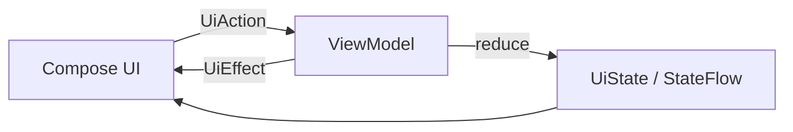
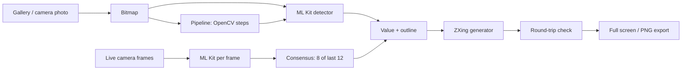

# Barcode 1D Improve

An Android learning project for **1D barcode detection, processing and generation**, built step by step with a modern Android stack. The goal is not a finished product but a codebase you can read, run and experiment with, to understand the whole pipeline and see exactly what happens at every stage.


<!-- Add screenshots here, for example:


-->

## What it does

- **Import** an image from the gallery (system photo picker) or take a photo with the system camera.
- **Detect** 1D barcodes with ML Kit and draw the detected outline on the image. Supported formats: EAN-13, EAN-8, UPC-A, UPC-E, Code 128, Code 39, Code 93, Codabar and ITF.
- **Process** the image with a stage-by-stage pipeline (OpenCV) and flip between the original and every intermediate result. Each stage shows its processing time and whether a barcode could be decoded on it.
- **Scan live** with the camera (CameraX) and accept a value only when it is confirmed by several consecutive frames, so random misreads are rejected.
- **Generate** a fresh barcode from a detected value (ZXing) and check it by decoding your own generated image (round trip).
- **Show it full screen** at maximum brightness, so another phone or a scanner can read it from your display.
- **Export** the generated barcode as a lossless PNG to `Pictures/Barcode1D`, with the barcode type and number printed above the bars.

## Why this project exists (self-study)

The app was built in small steps, and each step added one concept and had its own checks. You can follow the same path: read the code for one step, run the app, verify the behavior, then move on.

| Step | Concept | What you learn |
|------|---------|----------------|
| 1 | Project setup | Koin, OpenCV initialization on Android |
| 2 | MVI skeleton | State, Action and Effect, a reducer in the ViewModel, `StateFlow`, one-off effects |
| 3 | Gallery import | Photo picker, `ImageDecoder`, software bitmaps, EXIF rotation |
| 4 | Detection | ML Kit barcode scanning, drawing an overlay in Compose Canvas |
| 5 | Pipeline abstraction | `ProcessingStep`, OpenCV `Mat` and native memory release, per-stage results |
| 6 | First image operations | Grayscale, CLAHE, detection on any pipeline stage |
| B1 | Camera photo | `TakePicture`, `FileProvider`, runtime permission |
| B2 | Barcode generation | ZXing, symbology mapping, round-trip verification |
| B3 | Full-screen display | Pixel-exact rendering, brightness, keep-screen-on |
| B4a | Live preview | CameraX `PreviewView`, camera lifecycle |
| B4b | Frame analysis | `ImageAnalysis`, backpressure, mapping frame coordinates to the preview |
| B4c | Consensus | Accepting a result only when it repeats across frames |
| B4d | From live scan to output | Reusing generation and display for a verified value |
| B5 / B6 | Export | MediaStore without storage permission, composing a labeled image |

## Lessons learned along the way

- **Verify your configuration before blaming the image.** Detection first failed on a sharp barcode because the scanner was limited to two formats. The barcode was ITF, which was not enabled.
- **ITF has no mandatory check digit**, so a misread can look perfectly valid. In live scanning, wrong reads were only a few percent of frames and all different, while the correct value repeated hundreds of times. Voting across frames (here 8 of the last 12 frames with a read) rejects them.
- **Prefer no result to a wrong result.** The live screen shows nothing as verified until the consensus rule is met.
- **A barcode generated from a decoded value is only as good as the decode.** The round-trip check proves the image was drawn correctly, not that the original read was right, which is why the live-scan path with consensus exists.
- **Pre-processing that makes an image look better does not always help a decoder.** Grayscale and CLAHE made no difference for ML Kit on the test images, because it already normalizes luminance and contrast internally.

## Architecture

The app uses **MVI**: the UI sends actions, the ViewModel reduces them into an immutable state, and one-off events (like messages) go through a separate effect channel.



Data flow of the app:



### Tech stack

| Area | Choice |
|------|--------|
| Language | Kotlin |
| UI | Jetpack Compose, Material 3 |
| Architecture | MVI, Coroutines and Flow |
| Dependency injection | Koin |
| Image processing | OpenCV 4.9.0 (Android, Maven Central) |
| Barcode detection and decoding | ML Kit Barcode Scanning 17.3.0 (bundled model, works offline) |
| Barcode generation | ZXing core 3.5.3 |
| Camera | CameraX 1.4.1 |
| Min SDK | 29 (Android 10) |

### Project structure

```
app/src/main/java/eu/barcode_1d_improve/
├── App.kt              Application class, Koin and OpenCV initialization
├── MainActivity.kt     Simple screen switching between the two screens
├── di/                 Koin modules
├── mvi/                Base classes for State, Action, Effect and the MVI ViewModel
├── data/               Image loading, barcode detector and generator, exporter, symbologies
├── imaging/            Processing steps and pipeline, frame analyzer, barcode rendering
└── restoration/        Compose screens, ViewModels and contracts (restoration and live scan)
```

## Getting started

**Requirements:** a recent Android Studio (it includes the required JDK) and a device or emulator with Android 10 (API 29) or newer. A physical device is recommended for the live camera features.

```bash
git clone https://github.com/<your-username>/<repository-name>.git
```

1. Open the project in Android Studio and let Gradle sync.
2. Run the `app` configuration on a device or emulator.
3. OpenCV adds native libraries for several CPU architectures, so the first build and the APK are larger than a typical sample app.

**Permissions:** `CAMERA` only (for live scanning and taking photos). Saving images uses MediaStore and needs no storage permission. The app code needs no network access.

## How to try it

1. Tap **Import** (or **Camera**) and choose a photo containing a 1D barcode.
2. Tap **Detect**: the outline and the decoded value appear.
3. Tap **Run pipeline** and select the stages. Use **Detect** on each stage and compare the markers.
4. Tap **Generate**, then **Full screen** or **Save to gallery**.
5. Tap **Live scan**, point the camera at a barcode and wait for **Verified**. Then use **Full screen barcode** or **Save image**.

Good test material is barcodes on product packaging, labels with 20-digit ITF barcodes, and your own photos of scratched, faded, crumpled or poorly lit codes. No sample images are included in this repository.

## Known limitations

- The image pipeline currently contains only Grayscale and CLAHE. Sharpening, deblurring, thresholding and deskewing are planned.
- A barcode bent sharply along the vertical axis was not detected in testing.
- **Save image** in live scan can still create several copies if tapped repeatedly.
- Old camera photos are not yet removed from the app cache.
- There are no automated tests yet.
- Rotating the device while the full-screen barcode is shown returns to the live scan screen.

## Roadmap

- Parameter sliders for processing steps, then unsharp mask, motion-blur deconvolution, thresholding and deskew.
- Side-by-side comparison of the original and processed image, and export of processed images.
- Unit tests, cache cleanup, and removal of the duplicated generate-and-check logic from the restoration ViewModel.

## Disclaimer

This is a learning project. It is not intended for production, safety-critical or inventory-critical use. Always verify decoded values independently.

## Contributing

Issues and suggestions are welcome, especially ideas for additional image-processing steps and difficult test cases.

## License

<!-- Choose a license before publishing, for example MIT or Apache-2.0, and add a LICENSE file. -->

## Acknowledgments

[OpenCV](https://opencv.org/), [ML Kit](https://developers.google.com/ml-kit), [ZXing](https://github.com/zxing/zxing), [CameraX](https://developer.android.com/training/camerax), [Koin](https://insert-koin.io/) and [Jetpack Compose](https://developer.android.com/jetpack/compose).
